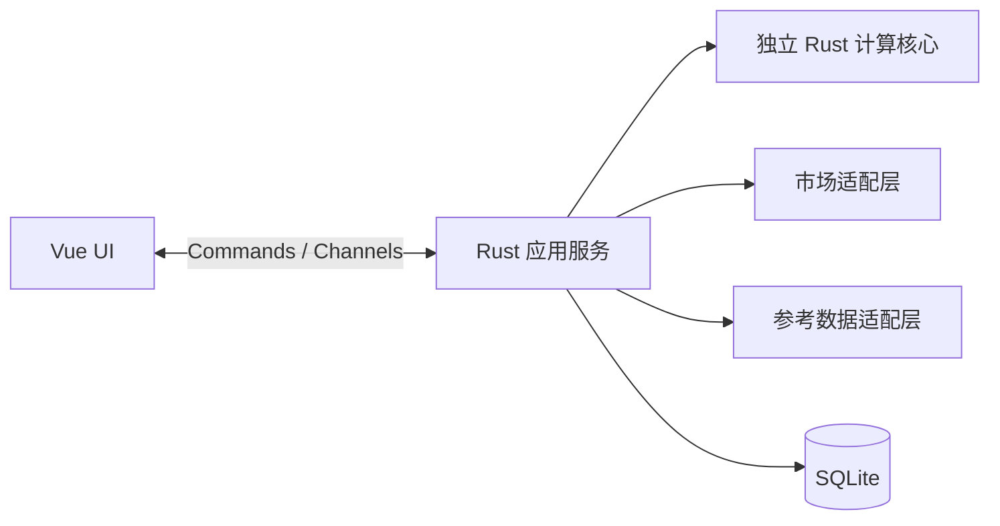

# wf-market 客户端项目需求

## 目标

构建一个桌面客户端，获取 Warframe 交易市场信息，并以清晰、可操作的界面呈现紫卡相关市场与配装能力。市场信息接入允许比较两条候选路径：使用 `wf-market` Rust 库，或直接调用经核实的市场 API；根据数据覆盖能力、维护成本、协议约束和验证结果确定最终方案，不要求同时实现两套，也不新增用户界面切换。客户端需要具备实时数据能力，REST 接口能力与 WebSocket 推送能力必须分别核实，不能把 REST API 文档当作紫卡实时推送可用的证据。

外部链接和核验状态统一记录在 [ExternalLinks.md](ExternalLinks.md)。其中此前在线文档初核显示 `wf-market` 提供可选的 `websocket` feature，但对应版本源码/API、紫卡市场事件与订阅覆盖范围、上游协议、授权方式和限流规则仍须以源码和实际联调为准，不能把订单实时示例直接视为紫卡行情支持。

外部资料按 P0–P4 作为查阅与评估优先级：P0 市场核心，P1 物品/翻译/模拟基础，P2 社区 API 与解析，P3 其他语言客户端，P4 辅助资料与探索。官方权威、项目相关性和核验状态分别判断；行情、游戏物品、译名、世界状态和社区统计不能混同，最终数据源尚未选定，不因新增资料扩展产品模块。

## 已确认的架构方案

- 平台：Windows 优先，保留未来 macOS/Linux 扩展能力；各平台分别验证布局、系统集成和安装包，首版不要求同时支持三平台。
- 技术栈：Tauri 2 桌面外壳；Vue 3 + TypeScript + Vite + Pinia 前端；Rust + Tokio 应用服务；独立 Rust 计算核心；SQLite 本地持久化。具体补丁版本和额外组件库暂不锁定。

| 层/组件 | 职责 |
| --- | --- |
| Tauri 桌面壳 | 窗口、生命周期、系统集成和打包 |
| Vue 前端 | 侧边栏四模块、表格、编辑器、交互和主题 |
| Rust 应用服务 | 网络、订阅、调度、数据转换和整合 |
| 独立 Rust 计算核心 | 词条分析、评分、洗卡建议和配装计算规则 |
| SQLite | 保存配装、设置和必要缓存 |

分层数据流为 UI ↔ Tauri Commands/Channels ↔ Rust 应用服务。应用服务分别调用独立计算核心、市场适配层、参考数据适配层和本地 SQLite。Commands 用于查询与操作，Channels 用于连续更新；市场列表采用批量更新，网络任务不阻塞 UI，较重计算在后台执行。前端不直接维护市场连接，也不实现核心公式。

市场适配层在统一业务接口之后封装 `wf-market`；若库缺少必要紫卡接口，可由适配层直接调用经核实的市场 API。UI 和计算逻辑使用本项目数据模型；两条接入路径的覆盖与取舍仍待验证，不要求完整双实现或界面切换，库支持订单 WebSocket 不等于紫卡 WebSocket 已验证。连接重连、限流、清理、去重和心跳继续遵守网络要求。

独立规则核心由四个功能复用，结果携带游戏数据版本、规则版本和适用条件，便于解释与复现；不编造评分模型或伤害公式。行情、游戏物品、社区统计和译名分别管理，以稳定 ID 关联；中英文名称只是展示字段，保留来源与时间，不能用译名作主键或把统计当挂单。

## 侧边栏模块

侧边栏必须提供以下四个功能入口：

1. **实时紫卡市场**：浏览紫卡行情并接收实时更新；筛选、排序和详情查看作为候选交互能力，字段、规则和优先级以实际数据模型及后续确认结果为准。
2. **紫卡词条分析**：分析当前紫卡词条，与热门成品进行对比，并对当前紫卡进行评价打分。热门的定义、样本口径、评分模型、权重和数据来源尚待确认；在这些规则确定前不得伪造热门数据或评分。
3. **紫卡洗卡指导**：依据当前词条、目标用途和分析结果提供洗卡建议。具体计算规则、目标配置和所需数据尚待确认，不承诺不可由数据支持的随机洗卡结果。
4. **配装模拟和保存**：编辑和计算配装，使用 SQLite 保存配装并支持重新加载。模拟规则、数据版本、数据结构、格式、迁移和缓存细节尚待设计；账号、云同步、交易自动化等不属于当前已确定范围。

## 后续候选功能

Market 账号登录与在线交易相关功能列为后续候选方向，具体操作范围与接入方式待后续确认；[ExternalLinks.md](ExternalLinks.md) 中的 Riven-Finder 可作为市场信息获取和登录流程的实现参考。其 README 描述的定期 API 轮询与客户端 WebSocket 需求分别核实。

## 网络与数据要求

- 实现 WebSocket 建连、断开处理、重连策略、订阅清理和消息去重；心跳机制以实际协议支持为准。
- 明确加载中、空数据、连接异常、重连中和数据过期等状态，并在界面提供可理解的反馈。
- 网络和数据任务不得阻塞界面交互。
- 行情数据与战斗模拟、词条规则数据可能来自不同来源，需分别核实来源、版本和一致性要求。
- [ExternalLinks.md](ExternalLinks.md) 中记录的 WFCD/warframe-items 可作为候选中英文翻译和物品数据参考；语言覆盖、名称/字段与市场标识映射仍待核实，不将其预设为确定的模拟或评分数据源。
- [ExternalLinks.md](ExternalLinks.md) 中记录的第三方翻译脚本可作为候选翻译方法参考；名称映射、搜索匹配、特殊物品译名处理及具体展示方式待源码与样本核实。

## 界面与交互要求

- 界面整体简洁美观，使用侧边栏组织功能，避免多余说明标签和重复文案。
- 支持亮色/暗色主题切换，两个主题下均保持足够的可读性和状态辨识度。
- 适配窗口宽度、高度和拖动变化：侧边栏、主内容区、表格、滚动区域和溢出处理都要在布局中考虑，并设置经过实际验证的最小窗口尺寸。
- 公共布局先行：侧边栏、内容区和统一颜色变量；窄窗支持侧栏收缩，矮窗合理滚动，长列表按需要采用虚拟滚动。
- UI 验收至少覆盖宽窗口、窄窗口、矮窗口以及亮色和暗色主题；具体尺寸在实际设计和实现验证后确定并记录。

## 待核实与待确认事项

- 核实 `wf-market` 对应版本的源码、构建方式和实际 API；验证紫卡市场事件与订阅覆盖范围，不能根据通用订单事件假定紫卡行情可直接订阅。
- 对比直接市场 API 与 `wf-market` 的紫卡数据覆盖、REST 能力、WebSocket 推送能力、维护成本和适配边界；不要求同时实现两条路径。
- 核实上游 WebSocket 或其他实时数据接口的协议、鉴权、心跳、限流、订阅和错误语义，并通过构建与联网联调确定适配边界。
- 确定热门成品数据来源、评分模型与权重、洗卡指导规则、配装模拟规则及数据版本。
- 设计 SQLite 的配装数据结构、格式、迁移细节，以及具体缓存策略和所需市场/模拟字段。

## 实施顺序

1. 获取真实紫卡数据，核实实际可用的实时更新能力。
2. 使用 Rust 整理数据，完成前端显示的首个技术验证。
3. 通路确认后建立公共布局和计算核心，接入词条分析、洗卡指导、配装保存。

账号与会话作为独立服务边界；Market 登录和在线交易仍是后续候选，具体操作范围待确认，不在本轮实现。

未确认的决策在方案和开发文档中留痕，不以推测替代事实；正式界面仅展示对用户有意义的状态和结果，不加入内部实施说明或待办标签。
