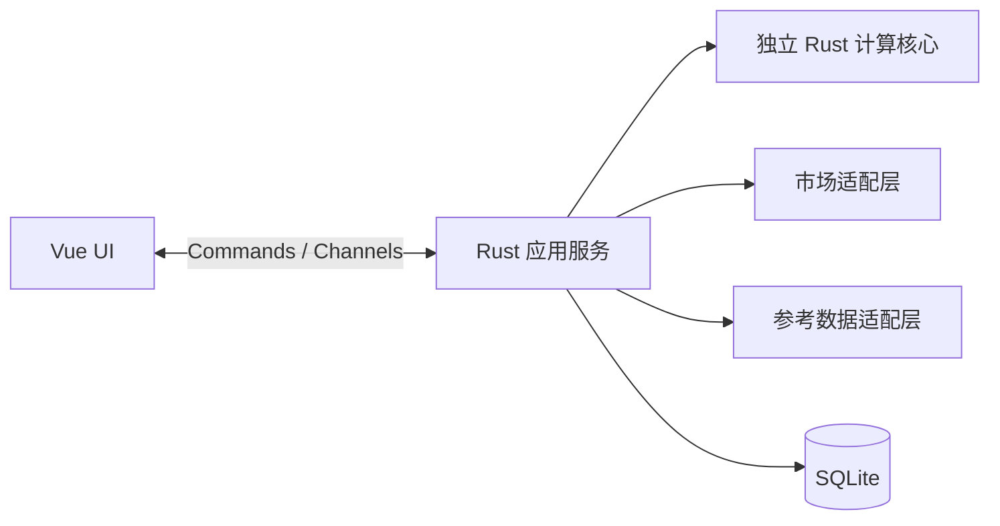

# wf-market 客户端项目需求

## 目标

构建一个桌面客户端，获取 Warframe 交易市场信息，并以清晰、可操作的界面呈现紫卡相关市场与配装能力。市场信息接入允许比较两条候选路径：使用 `wf-market` Rust 库，或直接调用经核实的市场 API；根据数据覆盖能力、维护成本、协议约束和验证结果确定最终方案，不要求同时实现两套，也不新增用户界面切换。客户端需要具备实时数据能力，REST 接口能力与 WebSocket 推送能力必须分别核实，不能把 REST API 文档当作紫卡实时推送可用的证据。

外部链接和核验状态统一记录在 [ExternalLinks.md](ExternalLinks.md)。其中此前在线文档初核显示 `wf-market` 提供可选的 `websocket` feature，但对应版本源码/API、紫卡市场事件与订阅覆盖范围、上游协议、授权方式和限流规则仍须以源码和实际联调为准，不能把订单实时示例直接视为紫卡行情支持。

外部资料按 P0–P4 作为查阅与评估优先级：P0 核心接口与开发约束，P1 物品/翻译/模拟基础，P2 社区 API 与解析，P3 其他语言客户端，P4 辅助资料与探索。官方权威、项目相关性和核验状态分别判断；行情、游戏物品、译名、世界状态和社区统计不能混同，最终数据源尚未选定，不因新增资料扩展产品模块。P0 同时包含当前已确认的 Hugeicons 官方图标与 Vue 集成资料，作为 UI 开发约束。

## 已确认的架构方案

- 平台：Windows 优先，保留未来 macOS/Linux 扩展能力；各平台分别验证布局、系统集成和安装包，首版不要求同时支持三平台。
- 技术栈：Tauri 2 桌面外壳；Vue 3 + TypeScript + Vite + Pinia 前端；Rust + Tokio 应用服务；独立 Rust 计算核心；SQLite 本地持久化。具体补丁版本和额外组件库暂不锁定。

| 层/组件 | 职责 |
| --- | --- |
| Tauri 桌面壳 | 窗口、生命周期、系统集成和打包 |
| Vue 前端 | 侧边栏四模块、表格、编辑器、交互和主题 |
| Rust 应用服务 | 网络、订阅、调度、数据转换和整合 |
| 独立 Rust 计算核心 | 词条分析、评分、洗卡建议和配装计算规则 |
| SQLite | 保存配装、设置和必要缓存 |

分层数据流为 UI ↔ Tauri Commands/Channels ↔ Rust 应用服务。应用服务分别调用独立计算核心、市场适配层、参考数据适配层和本地 SQLite。Commands 用于查询与操作，Channels 用于连续更新；市场列表采用批量更新，网络任务不阻塞 UI，较重计算在后台执行。前端不直接维护市场连接，也不实现核心公式。

市场适配层在统一业务接口之后封装 `wf-market`；若库缺少必要紫卡接口，可由适配层直接调用经核实的市场 API。UI 和计算逻辑使用本项目数据模型；两条接入路径的覆盖与取舍仍待验证，不要求完整双实现或界面切换，库支持订单 WebSocket 不等于紫卡 WebSocket 已验证。连接重连、限流、清理、去重和心跳继续遵守网络要求。

独立规则核心由四个功能复用，结果携带游戏数据版本、规则版本和适用条件，便于解释与复现；不编造评分模型或伤害公式。行情、游戏物品、社区统计和译名分别管理，以稳定 ID 关联；中英文名称只是展示字段，保留来源与时间，不能用译名作主键或把统计当挂单。

## 侧边栏模块

侧边栏必须提供以下四个功能入口：

1. **实时紫卡市场**：浏览紫卡行情并接收实时更新；筛选、排序和详情查看作为候选交互能力，字段、规则和优先级以实际数据模型及后续确认结果为准。
2. **紫卡词条分析**：分析当前紫卡词条，与热门成品进行对比，并对当前紫卡进行评价打分。当前已按用户授权实现 `sample-heuristic-v1` 挂牌估价首版，具体公式见 [riven-valuation.md](docs/riven-valuation.md)；评分和战斗模拟仍待后续规则确认，不伪造成交价或官方评分。洗卡指导已于 2026-11-09 接入完整 Rust core/planner，UI/native 验收仍待完成。
3. **紫卡洗卡指导**：依据当前词条、目标用途和分析结果提供洗卡建议。具体计算规则、目标配置和所需数据尚待确认，不承诺不可由数据支持的随机洗卡结果。
4. **配装模拟和保存**：编辑和计算配装，使用 SQLite 保存配装并支持重新加载。模拟规则、数据版本、数据结构、格式和迁移仍待设计；市场静态目录缓存已有单独的实施建议，账号、云同步、交易自动化等不属于当前已确定范围。

## 后续候选功能

Market 账号登录与在线交易相关功能列为后续候选方向，具体操作范围与接入方式待后续确认；[ExternalLinks.md](ExternalLinks.md) 中的 Riven-Finder 可作为市场信息获取和登录流程的实现参考。其 README 描述的定期 API 轮询与客户端 WebSocket 需求分别核实。

## 网络与数据要求

- 实现 WebSocket 建连、断开处理、重连策略、订阅清理和消息去重；心跳机制以实际协议支持为准。
- 明确加载中、空数据、连接异常、重连中和数据过期等状态，并在界面提供可理解的反馈。
- 网络和数据任务不得阻塞界面交互。
- 行情数据与战斗模拟、词条规则数据可能来自不同来源，需分别核实来源、版本和一致性要求。
- [ExternalLinks.md](ExternalLinks.md) 中记录的 WFCD/warframe-items 可作为候选中英文翻译和物品数据参考；语言覆盖、名称/字段与市场标识映射仍待核实，不将其预设为确定的模拟或评分数据源。
- [ExternalLinks.md](ExternalLinks.md) 中记录的第三方翻译脚本可作为候选翻译方法参考；名称映射、搜索匹配、特殊物品译名处理及具体展示方式待源码与样本核实。

## 界面与交互要求

- 界面整体简洁美观，使用侧边栏组织功能，避免多余说明标签和重复文案。
- Logo 暂用 `WM` 文字标识：亮色主题下 `W` 使用紫色、`M` 使用黑色；暗色主题下 `W` 使用紫色、`M` 使用淡白色。
- 侧边栏可收拢/拉开，四个功能均通过侧边栏导航；侧栏底部提供透明、无边框的设置触发器，展开态显示设置图标与“设置”文字，折叠态仅显示图标，点击弹出“设置”“关于”菜单，且两项均可打开对应界面。
- 收拢/展开控件使用小型 Hugeicons 图标按钮，置于侧栏与主界面分隔线的纵向中点，并随侧栏边界和窗口高度变化自动保持在整条分隔线的垂直中点，不参与 Logo 布局；按钮无边框、背景透明且无阴影，悬停时仅改变图标颜色。
- 界面图标统一使用 [Hugeicons](https://hugeicons.com/) 官方图标库，Vue 3 按 `Agent.md` 规定接入；不得以其他图标库、Emoji、Unicode 符号或临时手绘 SVG 替代。
- 亮色主题以接近白色的内容底和白色卡片为主，搭配淡紫侧栏、深紫导航条目与深紫选中层次（选中项使用白字）；紫色可从 `#4C2365`、`#7F5D99`、`#9E7EB5`、`#C4A4DA` 中配色，字色候选为 `#290044`。原 `#FEF3E2`、`#FCF0DA`、`#FCF9EA`、`#F5EFE3` 暖白调色盘保留为初始建议，不作为当前主底色要求。
- 暗色主题以紫色与灰黑色为主，可从上述紫色和 `#4A4A4A`、`#413333`、`#010736`、`#0D1C42`、`#22396F` 中配色，字色候选为 `#FCF1D0`。上述颜色是建议调色盘，应根据对比度和层次派生中性色，不要求每种颜色都直接上屏。
- 支持亮色/暗色主题切换，两个主题下均保持足够的可读性和状态辨识度。
- 用户已确认主题过渡使用专门的 `src/ui/themeTransition.ts` 文件；亮色/暗色入口统一经过该逻辑，基于当前根颜色连续过渡，重复切换合并，启动不播放入场动画，并遵守 `prefers-reduced-motion` 与 Web API 不可用时的直接切换回退。
- 适配窗口宽度、高度和拖动变化：侧边栏、主内容区、表格、滚动区域和溢出处理都要在布局中考虑，并设置经过实际验证的最小窗口尺寸。
- 公共布局先行：侧边栏、内容区和统一颜色变量；窄窗支持侧栏收缩，矮窗合理滚动，长列表按需要采用虚拟滚动。
- 当前实现采用内容优先的紧凑布局：自定义标题栏高 `36px`，桌面内容区内边距 `16px 16px 24px`，窄窗约 `14px 14px 20px`，矮窗顶部约 `12px`，页标题约 `24–26px`；按钮、输入框和下拉外框使用中等小圆角与单层细边框，静态内容卡片不使用阴影。
- UI 设计需考虑宽窗口、窄窗口、矮窗口以及亮色和暗色主题，并记录实际验证的尺寸与结果；每轮验收场景按本次或上次变更的影响范围选择，不要求每轮覆盖所有尺寸、主题和键盘路径。
- 当前 UI 外壳已获用户认可，市场请求通过 Rust/Tauri/Vue 纵向通路接入；静态目录 SQLite/Rust 缓存、随包 seed、Pinia 共享目录和设置页手动更新入口已实现。紫卡词条分析首版已接通本地范围、市场参考与用户授权的 `sample-heuristic-v1` 挂牌估价；洗卡指导 backend 已完成，网页/native 验收仍待完成。启动不自动联网更新，不宣称紫卡 WebSocket 实时推送、评分、配装模拟或完整游戏数据已完成，不得加入虚构行情数据。

## 待核实与待确认事项

- 核实 `wf-market` 对应版本的源码、构建方式和实际 API；验证紫卡市场事件与订阅覆盖范围，不能根据通用订单事件假定紫卡行情可直接订阅。
- 对比直接市场 API 与 `wf-market` 的紫卡数据覆盖、REST 能力、WebSocket 推送能力、维护成本和适配边界；不要求同时实现两条路径。
- 核实上游 WebSocket 或其他实时数据接口的协议、鉴权、心跳、限流、订阅和错误语义，并通过构建与联网联调确定适配边界。
- 确定热门成品数据来源、评分模型与权重、洗卡指导规则、配装模拟规则及数据版本。
- 缓存 current/previous 事务切换和失败回退已通过离线回归，后续继续 GUI 验收；配装 SQLite 结构仍待设计。市场目录缓存实现与证据记录在 [启动目录等待与静态数据缓存分析](docs/startup-data-cache-analysis.md) 和 [catalog-cache.md](docs/catalog-cache.md)。

## 实施顺序

1. 完成真实紫卡目录和按武器挂单的请求、解析与前端显示测试。
2. 继续核实可用的实时更新能力、限流和 WebSocket 边界。
3. 通路边界确认后建立计算核心，接入词条分析、洗卡指导、配装保存。

市场静态目录缓存已作为基础设施实现：SQLite/Rust 保存当前查询所需武器与词条目录及版本元数据，启动优先读取随包导入或本地缓存，更新仅由设置入口手动触发并按 `collections.rivens` 检查；不缓存实时挂单和在线状态，不将 Market API 版本当作游戏版本。当前/previous 快照事务切换已通过离线回归验证，证据见 [启动目录等待与静态数据缓存分析](docs/startup-data-cache-analysis.md)。

当前市场页交互范围已确认：默认只加载真实目录，不自动查询挂单；用户通过武器、正面/负面特性和价格顺序进行简单筛选，或在高级筛选中补充极性、最高段位等级、强化等级与 Re-rolls 范围后手动查询。简单与高级筛选共享同一份草稿条件，查询请求仅通过 Tauri IPC 发出；接口实测最高段位边界为 7–16，强化等级当前仅确认有限枚举 `maxed`（满级 8 级），不限时不发送该字段，Re-rolls 仅要求非负整数且最小值不大于最大值。高级筛选弹窗适当增加高度，为下拉留空间并受视口高度限制。

市场列表交互补充：词条方向通过绿色（正面）/红色（负面）样式和读屏 `aria-label` 表达，亮暗主题均需保持可读，不在可见文本重复“正面/负面”；输入下拉框只保留外层边框与焦点反馈，不增加外围卡片；表格展示用户状态、原始游戏极性图标、段位、强化等级和洗卡次数；每行支持操作菜单开关，当前仅提供禁用的购买请求、分享和相似筛选占位项，不执行任何业务动作。极性图标使用经核实的原始游戏图像并随程序本地打包，界面操作图标仍使用 Hugeicons。

市场模块保留四模块侧栏；市场模块内部预留三页：紫卡购买、WM 用户、我的上架。当前仅实现紫卡购买页，其余两页保持占位，不扩展登录或 v2 接口能力。

高级筛选范围控件使用“需要段位等级”和“洗卡次数”分组标题；需要段位等级仅保留最高值，接受两位 ASCII 数字并校验 7–16，洗卡次数保留最小值/最大值范围并接受八位 ASCII 数字，空值表示不限。

高级筛选布局中名称与极性同排，正面/负面特性独占整行，强化等级与最高段位等级同排，洗卡次数和价格排序独占整行；极性复用可搜索下拉并显示本地原始游戏图标，选择“不限”提交为 `null`。最高段位为单值输入，保留两位数字和 7–16 校验，洗卡次数保留八位数字范围。

市场排序下拉统一标记为“排序”，提供价格升序、价格降序、正面词条升序、正面词条降序四项。词条排序按当前批次内的词条数值进行多键比较，多选时按用户选择顺序依次比较，并标注仅限当前批次；不推断全市场排序算法。所有武器选择下拉在弹层内部提供六类紫卡类型浏览过滤（全部类型、步枪、霰弹枪、手枪、近战武器、ZAW、Kitgun）；类型过滤只影响候选显示，不自动改动已选武器、不触发网络请求，也不需要数据库更新。候选按英文名称 A–Z 排序，中文名称继续作为主要显示标签并支持中英搜索；未知类型保留原始类型标签。

界面样式规范：禁用按钮使用不可用光标而非等待光标，只有可用按钮显示 hover 反馈；主滚动区、设置/筛选弹窗和下拉列表统一使用主题 token 派生的细窄滚动条。

全局界面保持紧凑、简洁和单层边界：主次按钮高 `32px`，普通输入与 SearchSelect 外框最小高 `32px`，弹窗采用 `16px` 外围留白与轻阴影；仅弹出层保留轻阴影，Dock 与静态内容卡片不增加装饰性投影。

Windows 桌面窗口使用无系统装饰的自定义标题栏：侧栏背景延伸到窗口顶部，主区标题栏高 36px，仅保留拖动空白区、主题切换、最小化、最大化/还原和关闭按钮；按钮透明无边框，关闭 hover 可用红色反馈，浏览器预览中窗口动作禁用。

市场 Dock 保持独立底部 footer：主体宽度最多 288px、高 36px、三等分无边框槽位并贴合窗口底沿；按钮保留键盘焦点轮廓，图标与文字紧凑排列。内部按钮默认透明平整，使用统一中性灰；选中项仅保留极淡中性状态底色与清晰文字，不添加独立控件表面、投影、凹凸或装饰条，不改变页面滚动范围。

紫卡词条分析页当前接通已核实常规词条的本地范围、市场参考与 `sample-heuristic-v1` 估价：共享本地目录缓存，按武器类型和词条方向过滤，正面最多三条、负面最多一条，至少两条完整正面词条后才允许开始分析。未知或新增系数返回 `unsupported`，不伪造结果；图片/名称识别、评分和战斗模拟仍未实现。
分析页紫卡预览中的中文名称、英文名称及正负词条行居中显示。

紫卡分析当前前端范围已明确：默认使用国际服现行 D1.2 规则，保留历史倾向倍率模式；强化等级为 0–8（默认 8），高价参考挂单数为 1–50（默认 20），历史倍率仅在历史模式显示并允许手改。开始分析手动触发两个独立 IPC 请求，词条范围与市场参考分别加载/报错，旧异步结果不能覆盖新草稿；普通浏览器仅提示桌面应用，不伪造结果。词条范围只显示真实计算区间、输入值和“区间位置”，不引入评分档级或概率表述；官方周统计的 popularity 是相对热度指数，不反推成交频率，均价/中位价仅作统计参考；高价挂单是卖家要价样本，不是成交或高价值证明。估价使用同武器批次热门词条，similar 优先、nearest 兜底，3+1 为 damage、2+1 为 extreme，numeric 使用真实核心并按 rank 归一，周热度最多额外 2%；缺少 range 不当作零。分析数据状态只在设置页打开时读取本地状态，目录更新与分析参考数据更新相互独立。

范围提示补充约束：上传按钮居中，上传图片按钮旁提供透明无边框图标开关，默认显示预览，可隐藏/显示且保留表单和结果；分析表单左栏宽 480px、数值输入宽 145px；窗口宽度不超过 1100px 时切换单列。空输入以灰色 placeholder 显示真实本地范围。新增或删除任意正/负槽位时批量重算所有已选项，单独修改词条只请求该项；修改 value 不触发范围请求且不覆盖用户值。请求使用稳定 id/context 与 row generation 丢弃旧响应；`riven_analysis_range_hints` 为本地 IPC，不发市场 HTTP。范围提示复用 `layout_factors`、`theoretical_value` 与同源 reference，并以和 `analyze` 的一致性测试保障行为，不宣称完整 helper 重构。

账号与会话作为独立服务边界；Market 登录和在线交易仍是后续候选，具体操作范围待确认，不在本轮实现。

### 紫卡词条展示分类（本地元数据）

前端使用随包的 `src/data/riven-attribute-presentation.json` 作为词条展示分组配置，版本为 1，分为核心、元素、物理、派系、其他和熔接六组，共覆盖随包目录当前 50 个词条 slug，且不重复。该文件是本地展示元数据，不新增 SQL 迁移，也不宣称 SQLite 已逐条保存分类；现有 SQLite 仍是整包目录缓存。分类顺序与 slug 以现有 seed 实际字段为准，未知词条继续回退到“其他”。

网站用户来源 `https://wxhn1225.github.io/riven-roll/#/ranges` 已看到步枪的核心/元素/物理/派系/其他/熔接六组及满级 D1.2 四布局范围；近战页面核实四个近战新增项位于熔接组。该第三方页面用于展示分类参考，公式源码与 solver 已于 2026-11-09 完成定向核对并接入；不宣称官方规则。

本轮实现记录：正面/负面下拉分类列在本页加宽、加高；仅本页启用，root Web/mock 定向验收已通过，证据与限制见 Current.md，不代表 native GUI 或完整构建。

未确认的决策在方案和开发文档中留痕，不以推测替代事实；正式界面仅展示对用户有意义的状态和结果，不加入内部实施说明或待办标签。

2026-11-09：洗卡 core/planner 已完成源作者实现接入与定向验证；熔接范围 776 oracle 对照及真实分析 API 2+1/2+0 测试已完成。root 已完成真实 Rust fixture Web/mock IPC 验收（常规规划+保留新卡、免费熔接、宽高主题）；native 与完整构建不在本轮结论内。
